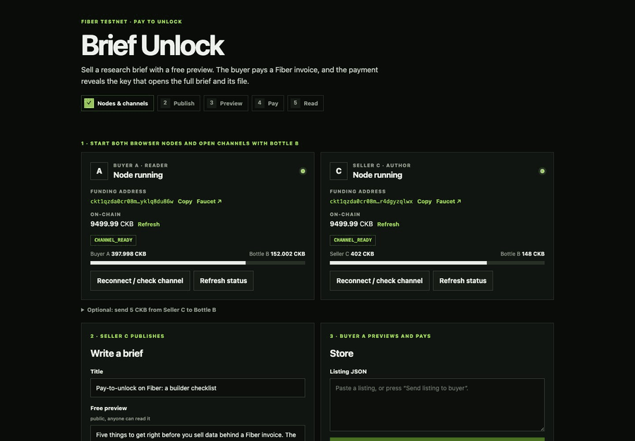

# Brief Unlock

Sell a research brief with a free preview over a Fiber payment on CKB Testnet.
The buyer reads the title and preview for free and pays the listed price
through a Fiber invoice. The payment reveals the AES key that opens the full
brief and its attached file.

Built from the starter project in the Fiber tutorial
[Unlock Encrypted Data with a Fiber Payment](https://www.fiber.world/docs/build/encrypted-data-payment)
(Fiber v0.10.1, `@fiber-pay/sdk` 0.3.1). Testnet only.



Video (37 s, WebM): [docs/demo/brief-unlock-demo.webm](docs/demo/brief-unlock-demo.webm)

## How it works

1. **Seller C writes a brief.** It has a title, a free preview, a price (1, 2 or
   5 CKB), the full text, and an optional file of up to 256 KB.
2. **Encrypt and list.** The browser makes a fresh AES-256 key and encrypts the
   text and the file together with AES-GCM. The public listing (title, preview,
   price, word count, file name, type and size) is passed to AES-GCM as
   *additional authenticated data*. The listing stays readable, but any change
   to it makes decryption fail. Seller C creates a Fiber invoice for the listed
   price and uses the AES key as the payment preimage.
3. **Buyer A loads the listing.** Before showing the store card, the app decodes
   the invoice and checks the network (`Fibt`), that the amount equals the
   listed price, and that the payment hash matches the listing.
4. **Try without paying.** A guessed key is rejected by AES-GCM.
5. **Pay.** Buyer A pays through Bottle B (A → Bottle B → C). To settle, the
   seller's node reveals the preimage. The app checks that
   `SHA-256(revealed key) == payment hash`.
6. **Unlock.** The revealed key decrypts the brief and the file (an image is
   shown inline and can be downloaded). An **integrity test** button tries the
   same key against an edited preview and shows that it is rejected.

## What changed from the starter

| Area | Starter | Brief Unlock |
| --- | --- | --- |
| Content | One plain-text result | Listing with title, free preview, price and word count, plus the full brief and an optional encrypted file |
| Price | Fixed 1 CKB | Seller picks 1, 2 or 5 CKB; the invoice is for that amount |
| Offer format | `version: 2` | `version: 3` with a validated `listing` object (`lib/listing.ts`); unknown fields are dropped |
| Encryption | AES-GCM over the text | AES-GCM over `{ body, file }`, with the listing as additional data (`lib/crypto.ts`) |
| Invoice check | Amount must be 1 CKB | Amount must equal the listed price (`lib/payment.ts`) |
| After payment | Decrypt the text | Check SHA-256(key) against the payment hash, decrypt the text and the file, show or download the file, run the integrity test |
| Node cards | Address and channel state | Adds the on-chain balance, a faucet link and a balance bar for each channel |
| Channel status | Manual refresh | Checks every 5 s while a channel is opening **or its Bottle connection is not up yet**, and shows "Connecting to Bottle…" |
| UI | Minimal form | Step tracker, seller form, store card with a locked preview, receipt, unlocked view |
| Tests | 9 payment tests | +1 price-mismatch test (`payment.test.mjs`), +5 crypto and listing tests (`brief.test.mjs`) |

These starter files are unchanged and keep their safety logic:
`lib/payment-submission.ts` (a payment is never resent while its outcome is
unknown), `lib/node-session.ts`, `lib/fiber.ts`, `lib/channel-funding.ts` and
`lib/fiber-testnet-runtime.ts`. `lib/progress.ts` only changes its session
storage key, so old v2 offers are not restored.

New files: `lib/listing.ts`, `lib/balance.ts`, `lib/sample.ts`, `brief.test.mjs`.

## Run it

You need Node.js 22.18 or newer.

```sh
npm install
npm run dev          # http://localhost:3001
# or a production build:
npm run build && npm start
```

Use `localhost` or HTTPS. The Fiber WASM node needs a secure context,
SharedArrayBuffer and cross-origin isolation, and `next.config.mjs` sets the
COOP/COEP headers. Avoid changing code while the nodes are running: a dev-mode
hot reload stops both nodes. Press **Start node** again to resume, and the
saved keys and channels are reused.

1. Press **Start node** for Buyer A and for Seller C. Copy each funding address
   into the [CKB Testnet faucet](https://faucet.nervos.org/). Each node needs
   more than 500 CKB.
2. Press **Open 500 CKB channel** on both cards and wait for `CHANNEL_READY`.
   This usually takes about a minute.
3. As the seller, edit the brief or keep the sample, pick a price, optionally
   attach a file (try `docs/sample/checklist-card.png`), then press
   **Encrypt & list**.
4. Press **Send listing to buyer →** and then **Load listing**. You can also copy
   the JSON and paste it into the buyer box.
5. Press **Try to open without paying** (it is rejected), then **Pay N CKB &
   unlock**, then **Decrypt with revealed key**.

Checks:

```sh
npm run typecheck
npm test             # 15 tests
npm run build
```

## A recorded Testnet run

These screenshots are from one run on CKB Testnet on 2026-11-18, in Chromium
140 with the production build.

| Step | Screenshot |
| --- | --- |
| Both channels `CHANNEL_READY` | [02-channels-ready.png](docs/demo/02-channels-ready.png) |
| Seller form, 2 CKB, PNG attached | [03-seller-form.png](docs/demo/03-seller-form.png) |
| Listed, with the public listing JSON | [04-seller-published-listing-json.png](docs/demo/04-seller-published-listing-json.png) |
| Buyer store card, invoice checked | [05-buyer-store-preview.png](docs/demo/05-buyer-store-preview.png) |
| Decryption rejected without the key | [06-buyer-decryption-rejected.png](docs/demo/06-buyer-decryption-rejected.png) |
| Receipt: 2 CKB + 0.002 CKB fee, hash check passed | [07-payment-receipt.png](docs/demo/07-payment-receipt.png) |
| Channel balances after payment | [08-channel-balances-after.png](docs/demo/08-channel-balances-after.png) |
| Unlocked brief, file, integrity test | [09-unlocked-brief-and-file.png](docs/demo/09-unlocked-brief-and-file.png) |
| Whole page | [00-overview-full-page.png](docs/demo/00-overview-full-page.png) |

Payment hash of that run:
`0x31d4a1a0ce41522bc1b2edd653584715eae8024442ed8c227fcd2f82b5cedfa3`.
In that run the receipt appeared about 1.1 s after pressing Pay (one
measurement, not a benchmark).

## Limits

- Both roles run in one page so the demo is self-contained. In real use the
  seller runs separately and publishes the listing JSON, which holds no key.
- A payment proves that the revealed key opens this ciphertext. It does not
  prove that the brief is accurate. Previews, reputation and refunds have to
  cover that.
- Invoices expire after one hour. The file limit is 256 KB because the
  ciphertext travels inside the listing JSON.
- Use Testnet only. Never send Mainnet CKB to these addresses.

Screenshots of the original tutorial run (Quest 1) are in
[docs/quest-1-tutorial](docs/quest-1-tutorial).
